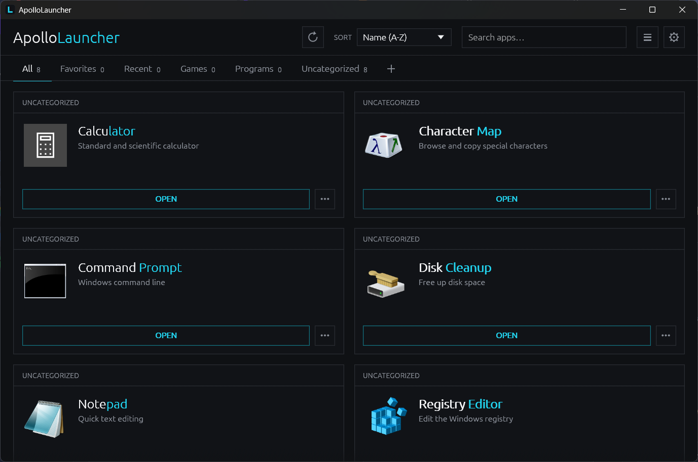
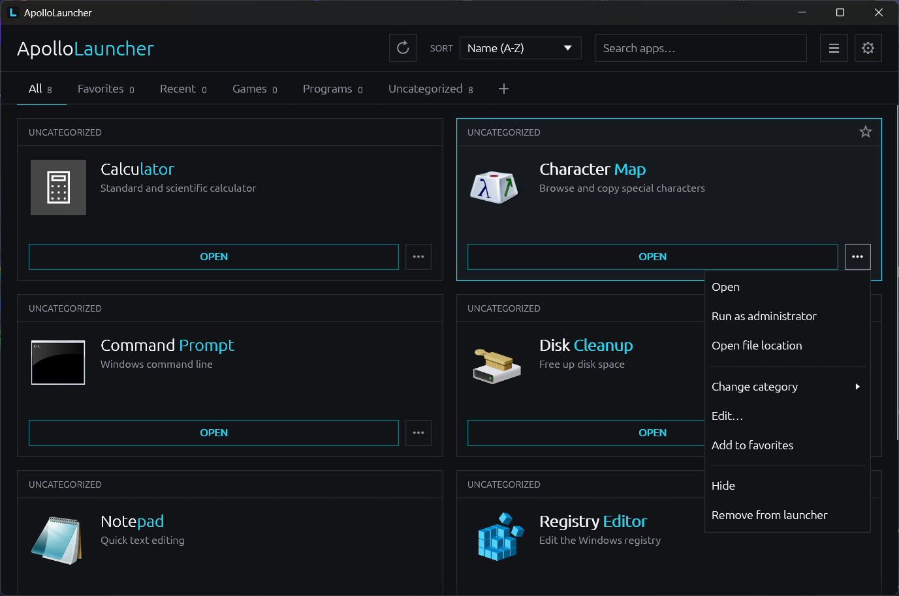
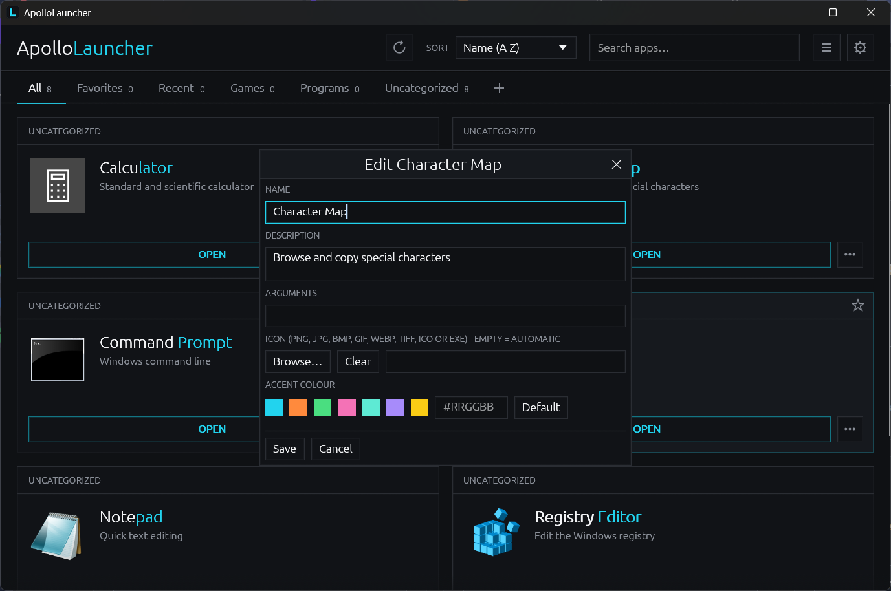
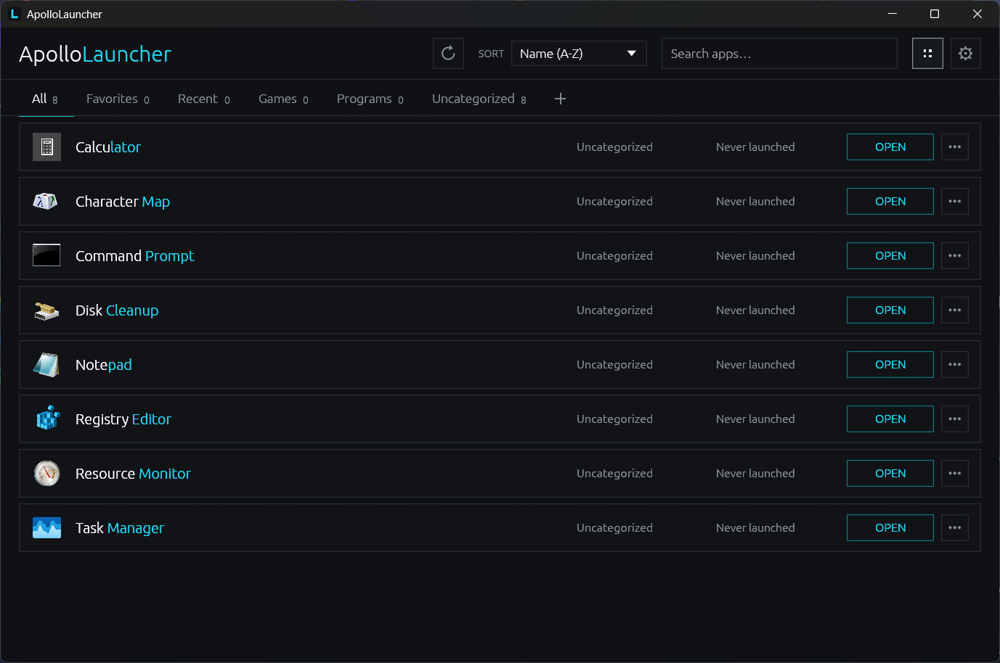
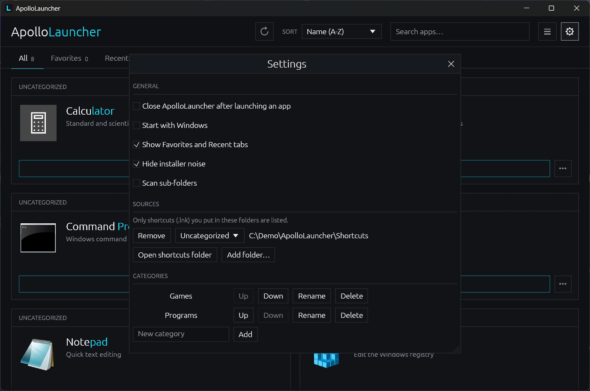

<div align="center">

# ApolloLauncher

**A fast, dark, flat app launcher for Windows, where you decide what's in it.**

Part of the **Apollo Project**.




</div>

---

## Why ApolloLauncher

Most launchers crawl your drives and fill themselves with every `.exe` they find. ApolloLauncher does the opposite: **nothing appears unless you put it there.** Drop a shortcut in a folder, drag a file onto the window, or press `+`, and that is the whole workflow.

- **Curated by you.** No drive is ever scanned for executables.
- **Everything editable in the GUI.** Name, description, arguments, accent colour and icon, with no config files to touch.
- **Automatic icons, overridable.** Uses the shortcut's icon, then the exe's icon, then a letter tile. Replace it with any PNG, JPG, BMP, GIF, WebP, TIFF, ICO, EXE or DLL.
- **Portable.** One exe. Your data lives in a `data` folder next to it, so you can carry it on a USB stick.
- **Fast and small.** Native Rust with an immediate-mode UI. No Electron, no runtime to install.
- **Live.** Add or remove a shortcut in the folder and the launcher updates on its own.

## Screenshots

| Card menu | Edit an app |
| :---: | :---: |
|  |  |

| List view | Settings |
| :---: | :---: |
|  |  |

## Install

### Portable (no install)

Download `ApolloLauncher.exe` and run it. It creates a `data` folder beside itself on first start. Move the exe and the folder together to take your setup with you.

### Installer (.msi)

`ApolloLauncher-<version>.msi` installs for the current user only, so no admin rights are needed:

- Installs to `%LOCALAPPDATA%\Programs\ApolloLauncher`
- Adds a Start menu shortcut and an uninstall entry in *Apps & features*

## Using it

### Adding apps

- **Shortcuts folder.** Settings → Sources → *Open shortcuts folder*, then drop `.lnk` shortcuts in. They appear immediately.
- **Add app.** Use the `+` tab, or **drag and drop** a `.lnk` or `.exe` onto the window.
- **More folders.** Settings → *Add folder…*. By default only `.lnk` files are listed and sub-folders are not scanned; both are configurable.

### Editing an app

Open a card's `...` menu and choose **Edit…** to change its name, description, arguments, accent colour and icon. Descriptions are taken from the shortcut's own description when it has one.

**Browse…** sets a custom icon (images are resized to 128 px). **Clear** goes back to automatic.

### Card menu

Open, Run as administrator, Open file location, Change category, Edit, Favorite, Hide, and **Remove from launcher**, which drops the app for good (a shortcut inside the Shortcuts folder goes to the Recycle Bin).

### Also included

Search as you type, Favorites and Recent tabs, user-defined categories, sorting (name, recently launched, most launched, category), grid and list views, optional *close after launch* and *start with Windows*.

## Where your data lives

Everything is stored in `data\` next to `ApolloLauncher.exe`:

| Path | Contents |
| --- | --- |
| `data\config.toml` | Settings, categories, per-app overrides |
| `data\icons\` | Cached and custom icons |
| `data\Shortcuts\` | The default shortcuts folder |

If `config.toml` is ever corrupt, the launcher falls back to defaults and tells you with a toast. Set `APOLLOLAUNCHER_DATA_DIR` to relocate the folder. If the exe's folder is not writable, `%APPDATA%\ApolloLauncher` is used instead.

## Building from source

Requirements: a recent stable Rust toolchain on Windows.

```powershell
cargo build --release
cargo test
cargo clippy --all-targets
```

The output is `target\release\apollolauncher.exe`.

> The author builds with the `stable-x86_64-pc-windows-gnu` toolchain and llvm-mingw. If you use the standard MSVC toolchain, no extra setup is needed.

### Building the installer

```powershell
.\make-installer.ps1              # builds the release exe, then the MSI
.\make-installer.ps1 -SkipBuild   # reuse an existing release build
```

The first run downloads the WiX Toolset 3.14 binaries into `installer\.wix` (no install, no admin). The MSI is written next to the script as `ApolloLauncher-<version>.msi`. If the GNU toolchain's llvm-mingw is not on `PATH`, set `LLVM_MINGW_BIN` to its `bin` folder first.

## Project layout

```
src/            application source
assets/         icon
installer/      WiX definition for the MSI
docs/           screenshots
DECISIONS.md    design decisions
```

## Credits

ApolloLauncher is part of the **Apollo Project**. Made by Jan Beres with the help of Claude.

Released under the [MIT License](LICENSE).
